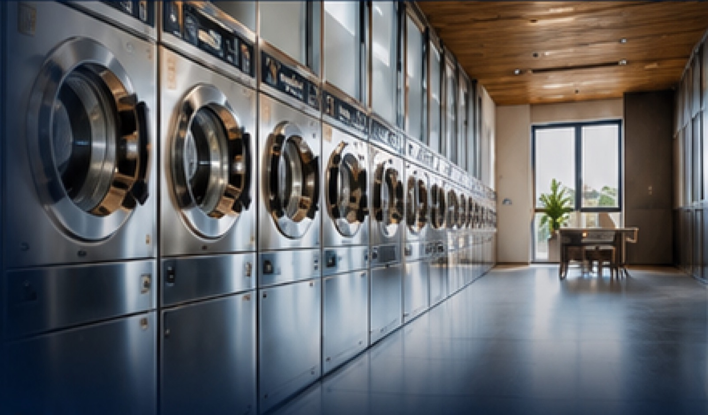

※この記事は書式見本のサンプルです。公開前に削除してください。

コインランドリーは、無人で運営できるビジネスとして土地活用や副業の選択肢に挙がることが増えています。一方で、事前の確認が不十分なまま開業すると、稼働率が伸びずに投資回収が長引くこともあります。

この記事では、開業前に確認しておきたいポイントを5つに絞ってご紹介します。

## 1. 商圏と競合を調べる

まず確認したいのは、出店候補地の周辺にどのような世帯が住んでいるかです。

- 単身世帯・共働き世帯の多さ
- 半径1〜2km圏内の競合店舗の数
- 車でのアクセスと駐車場の確保

## 2. 機器構成を決める

洗濯乾燥機、乾燥機、スニーカー用など、機器の組み合わせによって客層や売上は大きく変わります。**特定のメーカーに偏らず比較すること**が大切です。

## 3. 資金計画を立てる

購入・リース・レンタルなど、導入方法によって初期費用と月々の負担が変わります。

1. 初期費用（機器・内装・工事）
2. 月々の固定費（家賃・水道光熱費）
3. 想定売上と回収期間

> 収支シミュレーションは、複数のパターンで比較しておくと安心です。

## まとめ

開業の成否は、事前の準備で大きく変わります。Wash Peaksでは、商圏調査から開業後の運営まで一貫してサポートしています。詳しくは[コインランドリー開業支援](../service-coinlaundry.html)のページをご覧ください。
