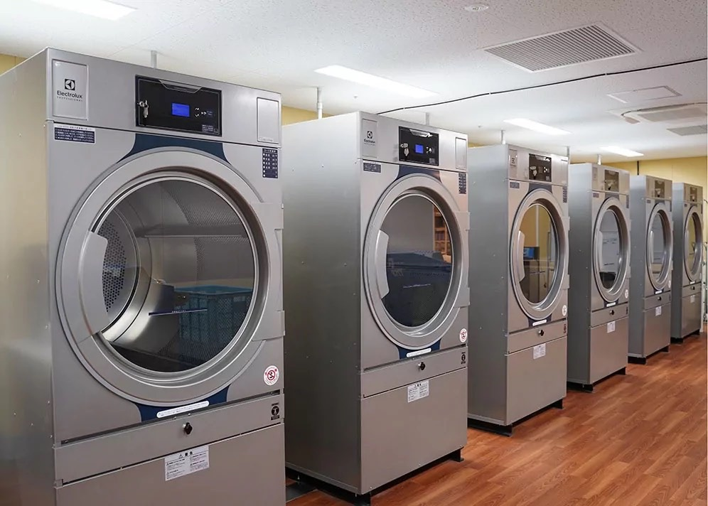
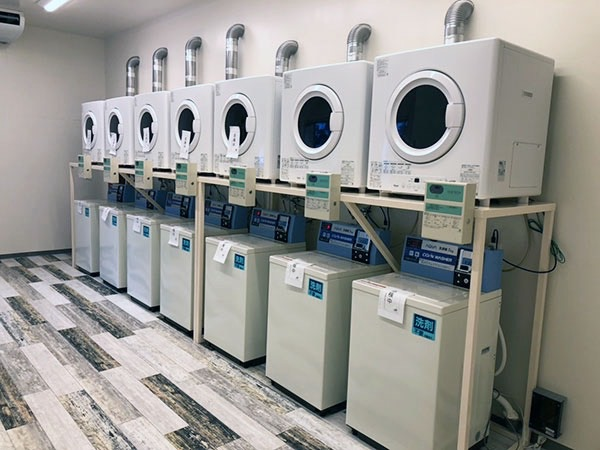

武蔵小杉における新店舗のオープンと、杉並店舗のリニューアルについてお知らせいたします。

いつも弊社サービスおよび店舗をご利用いただき、誠にありがとうございます。この度、武蔵小杉エリアにて新しい店舗をオープンするとともに、杉並エリアの店舗におきましてもリニューアルを実施いたしました。

本記事では、今回の武蔵小杉での新店舗オープンと杉並店舗のリニューアルの概要についてご紹介いたします。地域の皆様や施設の管理者様にとって、より使いやすく快適な洗濯環境をご提供できるよう整えております。

## 武蔵小杉の新店舗オープンについて

武蔵小杉エリアにおきまして、新店舗をオープンいたしました。

新店舗では、大型の洗濯乾燥機器を取り揃えており、日常生活でのまとめ洗いや、大型の布団・毛布などの洗濯にも対応できる環境を整えています。武蔵小杉周辺にお住まいの皆様や、近隣の事業者様にご活用いただける施設となっております。

業務用レベルのパワフルな機器を導入することで、短時間でしっかりと洗濯・乾燥を行うことが可能です。お忙しい日常の家事負担軽減や、業務用のリネン類の洗濯にもご利用いただけます。

## 杉並店舗のリニューアルについて

続いて、杉並エリアの店舗におきましてリニューアルを実施いたしました。

杉並店舗では、設備や配置の見直しを行い、より快適にご利用いただけるようリニューアルを行いました。機器の刷新やレイアウトの最適化により、スムーズに作業を行える環境を構築しております。

店内は清潔感を重視し、初めてご利用されるお客様でも安心して操作できるよう配慮しております。日頃からご利用いただいているお客様はもちろんのこと、新しくご利用をご検討されている方にもおすすめの空間となっております。

## コインランドリー開業・リニューアルのポイント

今回のような新店舗のオープンや既存店舗のリニューアルは、ご利用者の満足度向上や集客力の強化において非常に重要な要素となります。

コインランドリーの新規開業や店舗のリニューアルを行う際には、以下のようなポイントが大切です。

- **利用ニーズに応じた機器選定**
  地域特性やターゲット層に合わせて、大型機器を中心に配置するのか、標準的なサイズの機器を複数設置するのかを検討することが重要です。
- **作業動線とレイアウトの最適化**
  洗濯物を投入してから取り出し、たたむまでの動線がスムーズであると、ご利用者様にとって使いやすい店舗となります。
- **清潔感とメンテナンス性の確保**
  常に清潔な状態を保つことができるよう、お手入れしやすい機器や内装デザインを採用することが長期的な運営において役立ちます。

弊社では、コインランドリーの新規開業支援から既存店舗のリニューアル提案まで、幅広い内製化・店舗運営支援を行っております。

## まとめ

武蔵小杉での新店舗オープンおよび杉並店舗のリニューアルについてご紹介いたしました。新店舗・リニューアル店舗ともに、地域の皆様の快適な生活をサポートする施設として運用してまいります。

コインランドリーの新規開業や店舗のリニューアル、業務用洗濯機器の導入をご検討中の事業者様・オーナー様は、ぜひお気軽にご相談ください。

詳しいサポート内容や導入プランについては、以下のページをご覧ください。

- [コインランドリー開業支援](../service-coinlaundry.html)
- [料金・プラン](../plans.html)
- [無料相談](../contact.html)
