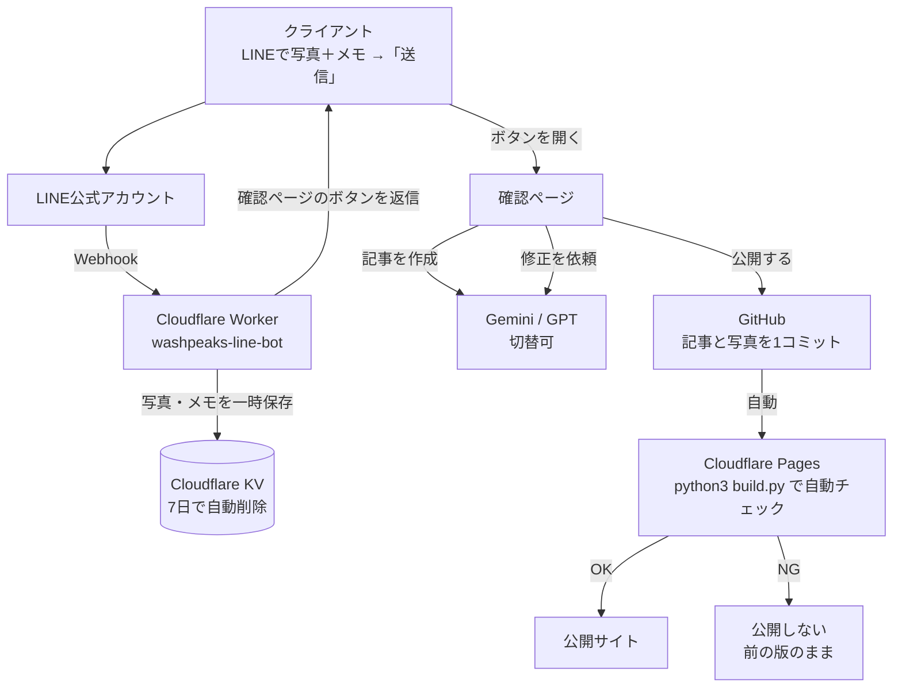

# 公開と LINE 投稿のしくみ

## 全体像



## クライアントの操作

1. LINE公式アカウントを友だち追加し、「登録 合言葉」と送る（初回のみ）
2. 写真（最大8枚）とメモを送る
3. 「送信」と送る → 「記事を作成・確認する」ボタンが届く
4. ボタンを開くと AI が記事を作成（30秒〜1分）。公開後と同じデザインで表示される
5. 内容を確認して
   - **公開する** → 1〜3分でサイトに反映
   - **修正を依頼** → 「タイトルを短く」などと書くと作り直す（何度でも可）
   - **やめる** → 下書きを破棄

LINE のコマンド: `取消`（送った写真・メモを破棄）/ `状態`（受付状況）/ `使い方`

## 設計上のポイント

| 項目 | 方針 | 理由 |
|---|---|---|
| 記事生成のタイミング | 確認ページを開いたとき | LINE の Webhook は短時間で応答する必要があり、その場で AI を待つと時間切れになるため |
| LINE の通知 | 返信メッセージのみ使用 | 返信は無料。月の通数制限を消費しない |
| 写真の縮小 | 公開ボタンを押したとき、確認ページ（スマホのブラウザ）で横1600pxに縮小 | 有料の画像変換サービスが不要 |
| 保存先 | Cloudflare KV のみ | 無料枠内。クレジットカード登録不要 |
| 投稿できる人 | 合言葉で登録した LINE ユーザーのみ | 友だち追加しただけの人は投稿できない |
| 確認ページ | 推測できない URL＋7日で失効、検索エンジン除外 | リンクを知っている人だけが開ける |
| AI の誤り対策 | 根拠のない数値・「業界初」・実在企業名の生成を禁止。推測した点は「確認してほしい点」に表示 | 公開前にクライアントが気づけるように |
| 壊れた記事 | 公開時と Cloudflare のビルド時に二重チェック | 不備があれば公開されず、サイトは前の状態のまま |
| AI の切替 | `wrangler.toml` の `AI_PROVIDER` を `gemini` / `openai` に変えて再デプロイ | 片方の仕様変更・障害時に切り替えられる |

## ファイル

```
worker/
├── wrangler.toml     設定（AI の切替、サイトURL、GitHub リポジトリ名）
├── package.json
└── src/
    ├── index.js      LINE受信・下書き管理・公開
    ├── page.js       確認ページ
    ├── ai.js         Gemini / OpenAI 呼び出し
    ├── prompt.md     AI への指示文（文章ルール・禁止事項）
    ├── github.js     GitHub へのコミット
    ├── line.js       LINE API
    └── markdown.js   本文の変換と検証（build.py と同じ規則）
```

AI の文章ルールを変えたいときは `worker/src/prompt.md` を編集して再デプロイする。
`docs/ai-instructions.md` は、ChatGPT / Gemini の画面で手動で記事を作る場合の指示文（内容は同じ方針）。

## 費用の目安（月）

| サービス | 費用 |
|---|---|
| Cloudflare Pages / Workers / KV | 無料枠内 |
| GitHub（非公開リポジトリ） | 無料 |
| LINE公式アカウント | 無料プラン（返信のみ使うため通数を消費しない） |
| Gemini API | 記事1本あたり数円程度（有料枠推奨。無料枠は入力内容が Google の改善に使われる） |
| OpenAI API（切替時） | 記事1本あたり数円〜数十円程度 |

準備手順は [`line-setup.md`](line-setup.md) を参照。
